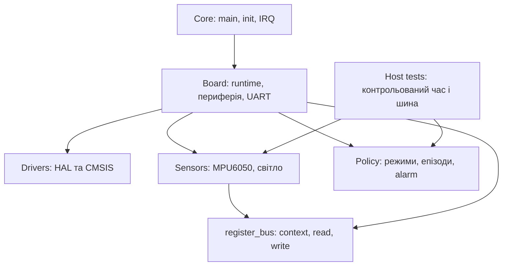

# Архітектура CargoSeal

Core залишає startup, clock/peripheral init та IRQ. Drivers містить незмінені HAL/CMSIS. Board з'єднує HAL із переносимими компонентами: регулярне опитування, GPIO, ADC, обмежений I²C та UART. Sensors працює через register_bus callbacks. Policy приймає значення й час, вирішує режими та події без доступу до регістрів.

Policy не визначає частоту опитування або піни. Board не визначає пороги руху чи світла. Тому host tests виконують ті самі функції класифікації, що й прошивка. Callback журналу не передає UART безпосередньо; runtime формує текст і ставить його в чергу. Черга обмежена пам'яттю, переповнення буде видимим у STATUS, без прихованого перезапису.

`python3 tools/check_layers.py` формально перевіряє include, hardware symbols та вихід локальних include за переносимі шари. Host compilation додає практичну перевірку. CubeMX calls залишаються в USER CODE, власні каталоги зберігаються при regeneration. .ioc описує конфігурацію; її відповідність коду перевіряється окремо.

